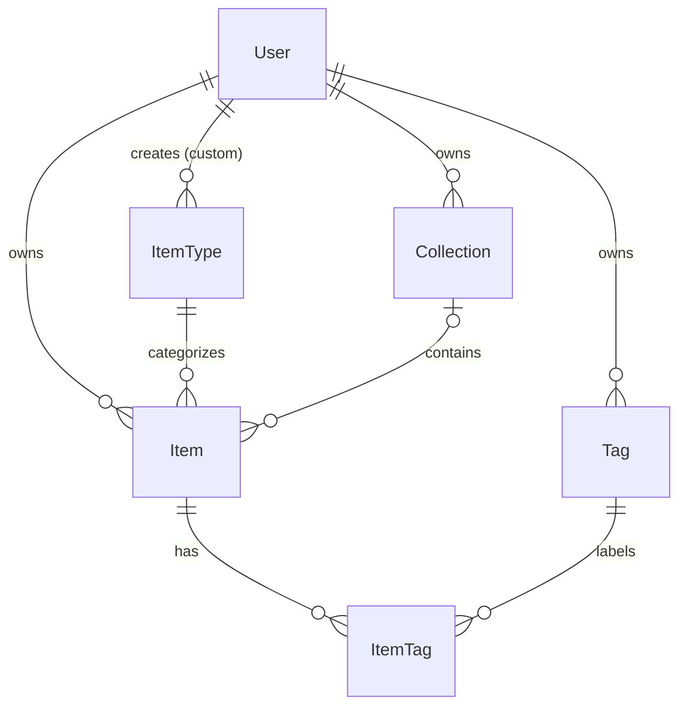
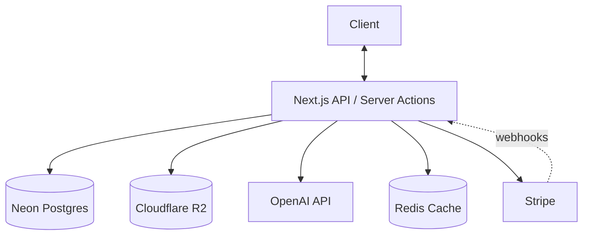
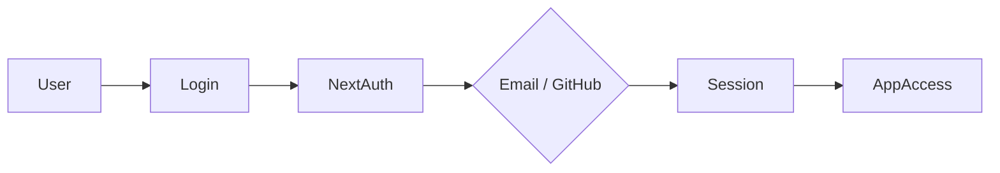
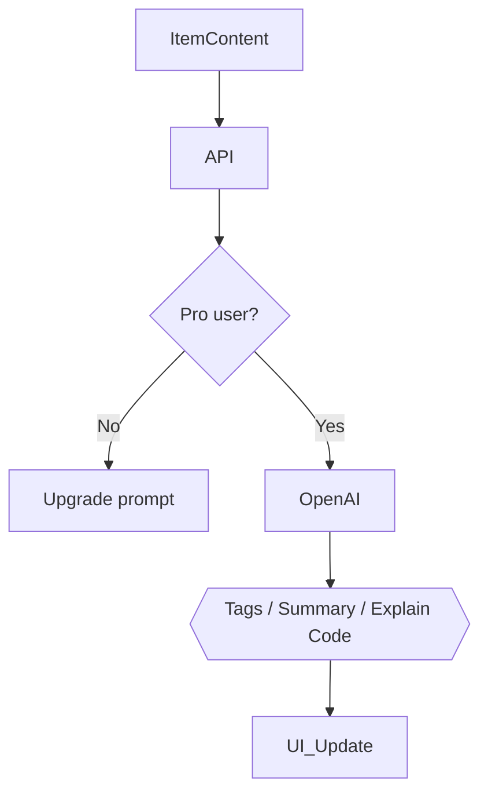

# 🚀 DevStash

> **Store Smarter. Build Faster.**
> A centralized, searchable, AI-enhanced hub for developer knowledge: code snippets, AI prompts, docs, commands, files, and links.


---

## 📑 Table of Contents

1. [Problem](#-problem)
2. [Target Users](#-target-users)
3. [Core Features](#-core-features)
4. [Data Model](#️-data-model)
5. [Tech Stack](#-tech-stack)
6. [Monetization](#-monetization)
7. [UI / UX](#-ui--ux)
8. [Architecture & Flows](#-architecture--flows)
9. [Development Workflow](#️-development-workflow)
10. [Roadmap](#-roadmap)
11. [Open Questions](#-open-questions)
12. [Status](#-status)

---

## 📌 Problem

Developers keep their essentials scattered across many tools:

| Where it lives today | What gets lost |
| --- | --- |
| VS Code / Notion | Code snippets |
| Chat histories | AI prompts |
| Buried in project folders | Context files |
| Browser bookmarks | Useful links |
| Random folders | Docs |
| `.txt` files | Commands |
| GitHub Gists | Project templates |
| Bash history | Terminal commands |

This causes **context switching, lost knowledge, and inconsistent workflows**.

➡️ **DevStash is ONE searchable, AI-enhanced hub for all dev knowledge and resources.**

---

## 🧑‍💻 Target Users

| Persona | Needs |
| --- | --- |
| 👨‍💻 Everyday Developer | Quick access to snippets, commands, links |
| 🤖 AI-First Developer | Store prompts, workflows, contexts |
| 🎓 Content Creator / Educator | Save course notes, reusable code |
| 🏗️ Full-Stack Builder | Patterns, boilerplates, API references |

---

## ✨ Core Features

### A) Items & System Item Types

Every item belongs to exactly one type. Built-in (system) types:

| Icon | Type | Content kind |
| --- | --- | --- |
| 💻 | Snippet | text |
| 🧠 | Prompt | text |
| 📝 | Note | text |
| ⌨️ | Command | text |
| 📄 | File | file |
| 🖼️ | Image | file |
| 🔗 | URL | link |

> ⭐ **Pro:** custom item types.

### B) Collections

Organize items into collections. **Mixed item types are allowed** in one collection.

Examples: `React Patterns`, `Context Files`, `Python Snippets`.

### C) Search

Full-text search across **content, tags, titles, and types**.

### D) Authentication

- 📧 Email + password
- 🐙 GitHub OAuth

### E) Additional Features

- ⭐ Favorites & 📌 pinned items
- 🕘 Recently used
- 📥 Import from files
- ✍️ Markdown editor for text items
- 📎 File uploads (images, docs, templates)
- 📦 Export (JSON / ZIP)
- 🌙 Dark mode (default)

### F) AI Superpowers

| Feature | Description |
| --- | --- |
| 🏷️ Auto-tagging | Suggest tags from item content |
| 📋 AI summaries | Short summary of an item |
| 💡 Explain Code | Plain-language explanation of a snippet |
| ✨ Prompt optimization | Improve stored prompts |

> Powered by **OpenAI `gpt-5-nano`**.

---

## 🗄️ Data Model

> This schema is a **starting point and will evolve**. Changes from the original draft: added NextAuth models, an enum for `contentType`, `onDelete` rules, indexes, and a unique tag name per user.



```prisma
generator client {
  provider = "prisma-client-js"
}

datasource db {
  provider = "postgresql"
  url      = env("DATABASE_URL")
}

enum ContentType {
  TEXT
  FILE
  URL
}

model User {
  id                   String   @id @default(cuid())
  email                String   @unique
  emailVerified        DateTime?
  name                 String?
  image                String?
  password             String?  // null for OAuth-only users
  isPro                Boolean  @default(false)
  stripeCustomerId     String?  @unique
  stripeSubscriptionId String?  @unique

  items       Item[]
  itemTypes   ItemType[]
  collections Collection[]
  tags        Tag[]
  accounts    Account[]
  sessions    Session[]

  createdAt DateTime @default(now())
  updatedAt DateTime @updatedAt
}

model Item {
  id          String      @id @default(cuid())
  title       String
  contentType ContentType // TEXT | FILE | URL
  content     String?     // text types
  fileUrl     String?     // Cloudflare R2 object URL
  fileName    String?
  fileSize    Int?        // bytes
  url         String?     // URL type
  description String?
  language    String?     // for syntax highlighting
  isFavorite  Boolean     @default(false)
  isPinned    Boolean     @default(false)
  lastUsedAt  DateTime?   // powers "Recently used"

  userId String
  user   User   @relation(fields: [userId], references: [id], onDelete: Cascade)

  typeId String
  type   ItemType @relation(fields: [typeId], references: [id])

  collectionId String?
  collection   Collection? @relation(fields: [collectionId], references: [id], onDelete: SetNull)

  tags ItemTag[]

  createdAt DateTime @default(now())
  updatedAt DateTime @updatedAt

  @@index([userId, typeId])
  @@index([userId, collectionId])
  @@index([userId, isFavorite])
  @@index([userId, lastUsedAt])
}

model ItemType {
  id       String  @id @default(cuid())
  name     String
  icon     String?
  color    String?
  isSystem Boolean @default(false)

  userId String? // null for system types
  user   User?   @relation(fields: [userId], references: [id], onDelete: Cascade)

  items Item[]

  @@unique([userId, name])
}

model Collection {
  id          String  @id @default(cuid())
  name        String
  description String?
  isFavorite  Boolean @default(false)

  userId String
  user   User   @relation(fields: [userId], references: [id], onDelete: Cascade)

  items Item[]

  createdAt DateTime @default(now())
  updatedAt DateTime @updatedAt

  @@index([userId])
}

model Tag {
  id   String @id @default(cuid())
  name String

  userId String
  user   User   @relation(fields: [userId], references: [id], onDelete: Cascade)

  items ItemTag[]

  @@unique([userId, name])
}

model ItemTag {
  itemId String
  tagId  String

  item Item @relation(fields: [itemId], references: [id], onDelete: Cascade)
  tag  Tag  @relation(fields: [tagId], references: [id], onDelete: Cascade)

  @@id([itemId, tagId])
}

// ---- NextAuth (Auth.js) models ----

model Account {
  id                String  @id @default(cuid())
  userId            String
  type              String
  provider          String
  providerAccountId String
  refresh_token     String?
  access_token      String?
  expires_at        Int?
  token_type        String?
  scope             String?
  id_token          String?

  user User @relation(fields: [userId], references: [id], onDelete: Cascade)

  @@unique([provider, providerAccountId])
}

model Session {
  id           String   @id @default(cuid())
  sessionToken String   @unique
  userId       String
  expires      DateTime

  user User @relation(fields: [userId], references: [id], onDelete: Cascade)
}

model VerificationToken {
  identifier String
  token      String   @unique
  expires    DateTime

  @@unique([identifier, token])
}
```

---

## 🧱 Tech Stack

| Category | Choice | Link |
| --- | --- | --- |
| Framework | **Next.js** (React 19) | [nextjs.org](https://nextjs.org) |
| Language | TypeScript | [typescriptlang.org](https://www.typescriptlang.org) |
| Database | Neon PostgreSQL | [neon.tech](https://neon.tech) |
| ORM | Prisma | [prisma.io](https://www.prisma.io) |
| Caching | Redis *(optional)* | [redis.io](https://redis.io) |
| File storage | Cloudflare R2 | [developers.cloudflare.com/r2](https://developers.cloudflare.com/r2/) |
| CSS / UI | Tailwind CSS v4 + shadcn/ui | [tailwindcss.com](https://tailwindcss.com) · [ui.shadcn.com](https://ui.shadcn.com) |
| Auth | NextAuth v5 (email + GitHub) | [authjs.dev](https://authjs.dev) |
| AI | OpenAI `gpt-5-nano` | [platform.openai.com](https://platform.openai.com) |
| Payments | Stripe | [stripe.com/docs](https://stripe.com/docs) |
| Deployment | Vercel *(likely)* | [vercel.com](https://vercel.com) |
| Monitoring | Sentry *(later)* | [sentry.io](https://sentry.io) |

---

## 💰 Monetization

| | 🆓 Free | ⭐ Pro |
| --- | --- | --- |
| **Price** | $0 | **$8/mo** or **$72/yr** (save 25%) |
| **Items** | 50 | Unlimited |
| **Collections** | 3 | Unlimited |
| **Search** | Basic | Full |
| **Image uploads** | ✅ | ✅ |
| **File uploads** | ❌ | ✅ |
| **Custom item types** | ❌ | ✅ |
| **AI features** | ❌ | ✅ |
| **Export (JSON / ZIP)** | ❌ | ✅ |

> 💳 **Stripe** handles subscriptions; **webhooks** keep `User.isPro` and subscription IDs in sync.

---

## 🎨 UI / UX

- 🌙 Dark mode first
- Minimal, developer-friendly interface
- Syntax highlighting for code
- Inspired by **Notion**, **Linear**, and **Raycast**

### Layout

```
┌──────────────┬──────────────────────────────────┐
│  Sidebar     │  Main workspace (grid / list)    │
│  (collapsible)│                                 │
│  • Types     │  ┌──────┐ ┌──────┐ ┌──────┐     │
│  • Favorites │  │ Item │ │ Item │ │ Item │     │
│  • Collections│ └──────┘ └──────┘ └──────┘     │
└──────────────┴──────────────────────────────────┘
         Item click → full-screen editor
```

### Responsive

- 📱 Mobile drawer for the sidebar
- 👆 Touch-optimized icons and buttons

---

## 🔌 Architecture & Flows

### API Architecture



### Auth Flow



### AI Feature Flow



---

## 🗂️ Development Workflow

*(Built as a course)*

- 🌿 **One branch per lesson** so students can follow and compare
- 🤖 AI assistance via **Cursor / Claude Code / ChatGPT**
- 🐞 Sentry for runtime monitoring and error tracking
- ⚙️ GitHub Actions for CI *(optional)*

```bash
git switch -c lesson-01-setup
```

---

## 🧭 Roadmap

### 🎯 MVP
- [ ] Items CRUD
- [ ] Collections
- [ ] Search
- [ ] Basic tags
- [ ] Free tier limits

### ⭐ Pro Phase
- [ ] AI features
- [ ] Custom item types
- [ ] File uploads
- [ ] Export
- [ ] Billing & upgrade flow

### 🔮 Future Enhancements
- [ ] Shared collections
- [ ] Team / Org plans
- [ ] VS Code extension
- [ ] Browser extension
- [ ] API + CLI tool

---

## ❓ Open Questions

Things I noticed while cleaning up the notes that are worth deciding early:

1. **Item ↔ Collection:** the schema allows one collection per item. Should an item be able to live in several? That would need a join table (`ItemCollection`).
2. **Free-tier uploads:** the notes list "image uploads" as free but "file uploads" as Pro. Confirm that Image items are free while File items are Pro-only.
3. **Search approach:** Postgres full-text search (`tsvector`) is likely enough for MVP; Prisma needs raw SQL or the `fullTextSearchPostgres` preview feature for it.
4. **Custom types in the schema:** system types have `userId = null`; make sure the seed script creates the 7 built-ins.
5. **Limit enforcement:** decide whether the 50-item / 3-collection limits are checked in server actions only or also at the DB level.

---

## 📌 Status

- 🟡 In planning
- ✅ Ready for environment setup and UI scaffolding

---

🏗️ **DevStash: Store Smarter. Build Faster.**
